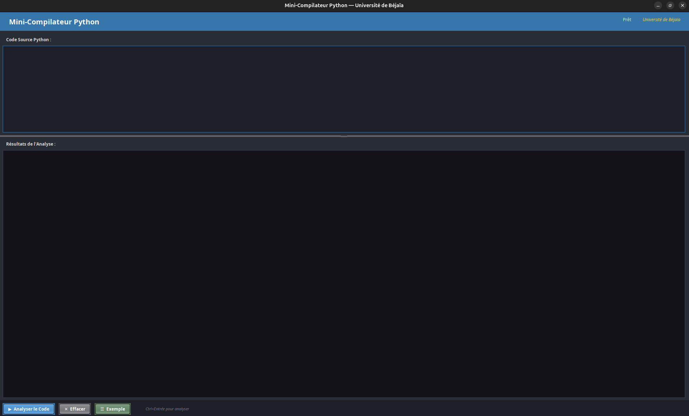

# Mini-Compilateur Python

Mini-compilateur écrit en **Java** qui réalise l'**analyse lexicale** et l'**analyse syntaxique** d'un sous-ensemble de Python, avec une interface graphique **Swing**.

Projet du module *Compilation* — 3ème année Ingénieur, Département d'Informatique, Université A/MIRA de Béjaïa (année universitaire 2025-2026).

📄 **Rapport du projet** : [Compte_Rendu-Compilation.docx](docs/Compte_Rendu-Compilation.docx) (à consulter pour le détail de la conception, de la grammaire et des tests).

## Fonctionnalités

- **Analyseur lexical** : transforme le code source en liste de tokens (mots-clés, identifiants, nombres, chaînes, opérateurs, délimiteurs).
- **Gestion de l'indentation à la Python** : tokens virtuels `INDENT` / `DEDENT` produits à l'aide d'une pile (tabulation = 4 espaces).
- **Analyseur syntaxique** par descente récursive qui valide la grammaire.
- **Erreurs localisées** : chaque erreur lexicale ou syntaxique indique la ligne concernée (indentation incohérente, chaîne non fermée, `:` manquant, bloc non indenté, expression invalide...).
- **Interface graphique** : éditeur de code, affichage coloré des tokens, résultat de l'analyse, bouton d'exemple, raccourci `Ctrl+Entrée`.

## Langage supporté (Mini-Python)

| Catégorie | Éléments |
|---|---|
| Littéraux | entiers, flottants, chaînes (`"..."` ou `'...'`), `True`, `False`, `None` |
| Affectation | `x = expression` |
| Opérateurs arithmétiques | `+` `-` `*` `/` (et `-` unaire) |
| Comparaison | `==` `!=` `<` `>` `<=` `>=` |
| Logiques | `and` `or` `not` |
| Structures de contrôle | `if` / `elif` / `else`, `while`, `for ... in ...` |
| Fonctions | `def nom(a, b):`, `return`, appels `f(x, y)` |
| Entrées/sorties | `print(...)` |
| Divers | commentaires `#`, séparateur `;` |

### Grammaire

```
programme     -> instruction* EOF
instruction   -> affectation | if_stmt | while_stmt | for_stmt | def_stmt | print_stmt | return_stmt
if_stmt       -> IF expression COLON NEWLINE bloc (ELIF expression COLON NEWLINE bloc)* (ELSE COLON NEWLINE bloc)?
while_stmt    -> WHILE expression COLON NEWLINE bloc
for_stmt      -> FOR IDENTIFIER IN expression COLON NEWLINE bloc
def_stmt      -> DEF IDENTIFIER LPAREN params? RPAREN COLON NEWLINE bloc
bloc          -> INDENT instruction+ DEDENT
expression    -> or_expr
or_expr       -> and_expr (OR and_expr)*
and_expr      -> not_expr (AND not_expr)*
not_expr      -> NOT not_expr | comparaison
comparaison   -> arithmetique (op_comp arithmetique)?
arithmetique  -> terme ((PLUS|MINUS) terme)*
terme         -> facteur ((TIMES|DIVIDE) facteur)*
facteur       -> MINUS facteur | atome | LPAREN expression RPAREN
atome         -> NUMBER | STRING_LITERAL | TRUE | FALSE | NONE | IDENTIFIER (LPAREN args? RPAREN)?
```

## Prérequis

- **JDK 8 ou supérieur** (testé avec JDK 21 ; le compte rendu mentionne JDK 23).
- Un environnement graphique (Swing).

## Compilation et exécution

Depuis la racine du projet :

```bash
mkdir -p out
javac -encoding UTF-8 -d out pythoncompiler/*.java
java -cp out pythoncompiler.PythonCompiler
```

Sous Windows (PowerShell / CMD) :

```bat
mkdir out
javac -encoding UTF-8 -d out pythoncompiler\*.java
java -cp out pythoncompiler.PythonCompiler
```

## Utilisation

1. Saisissez du code Python dans la zone **Code Source Python** (ou cliquez sur **Exemple**).
2. Cliquez sur **Analyser le Code** (ou `Ctrl+Entrée`).
3. La zone **Résultats de l'Analyse** affiche d'abord les tokens, puis le verdict de l'analyse syntaxique :
   - `✔ Code syntaxiquement correct` ;
   - ou le message d'erreur avec le numéro de ligne.
4. **Effacer** vide l'éditeur et la console.

Exemple de code valide :

```python
x = 10
y = 3
if x > y:
    print(x + y)
else:
    print("x est plus petit")

def calculer(a, b):
    return a + b
```


## Captures d'écran

### 1. Interface au démarrage



### 2. Cas normal : code correct

L'exemple est analysé sans erreur : les tokens sont listés puis le message `✔ Code syntaxiquement correct` s'affiche.


### 3. Cas d'erreur : erreur dans le code

Avec `x = 10we` à la ligne 2, l'analyse s'arrête et affiche
`Erreur ligne 2 : Fin de ligne attendue après l'instruction, mais 'we' (IDENTIFIER) trouvé.`


## Structure du projet

```
.
├── pythoncompiler/
│   ├── PythonCompiler.java   # Point d'entrée, Look & Feel
│   ├── CompilerGUI.java      # Interface Swing
│   ├── Lexer.java            # Analyse lexicale
│   ├── Parser.java           # Analyse syntaxique (descente récursive)
│   ├── Token.java            # Représentation d'un token
│   └── TokenType.java        # Énumération des types de tokens
├── docs/
│   └── Compte_Rendu-Compilation.docx
├── screenshots/
├── LICENSE
└── README.md
```

## Limites actuelles

- Le programme **analyse** le code, il ne l'**exécute pas**.
- Pas d'analyse sémantique (variables non définies, types...).
- Sous-ensemble limité : pas de listes/dictionnaires, d'opérateurs `+=`, `%`, `//`, `**`, de `import`, de classes, ni de corps de bloc sur la même ligne que `:`.

## Auteurs

- GUELAACHE Hocine
- ALLOUCHE Mokrane
- BOUKHENAK Kamel
- BOUNOUA Axil

## Rapport

Le compte rendu complet est disponible ici : [docs/Compte_Rendu-Compilation.docx](docs/Compte_Rendu-Compilation.docx).

## Licence

Distribué sous licence [MIT](LICENSE).
